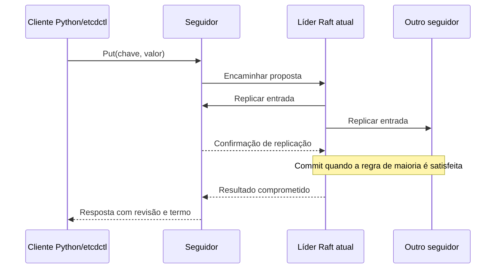
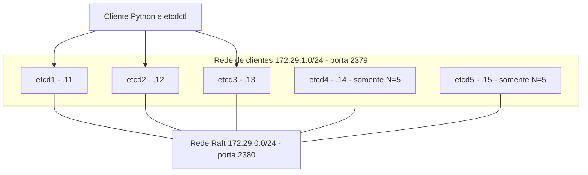

# M2 Sistemas Distribuídos

Replicação de estado e coordenação com etcd/Raft.

**Tema 5 - Estado/Coordenação | Ênfase A - Linearizável x serializável**

> Base de relatório para desenvolver e completar após executar os experimentos. Nenhum resultado numérico, falha observada ou conclusão experimental é declarado como realizado neste texto. Os campos **PENDENTE** devem ser preenchidos com evidências reais antes da entrega. A extensão final orientada no roteiro é de 15 a 25 páginas, sem anexos; este Markdown ainda não é essa versão diagramada.

## 1. Identificação

Universidade do Vale do Itajaí - UNIVALI. Disciplina: Sistemas Distribuídos. Professor: Ramices dos Santos Silva. Equipe: **PENDENTE**. Integrantes: **PENDENTE**. Repositório definido para publicação: [JallisonJimenez/m2-sistemas-distribuidos](https://github.com/JallisonJimenez/m2-sistemas-distribuidos). Data de execução: **PENDENTE**.

O escopo adotado é etcd com Raft e a ênfase A do Tema 5, conforme a seção 9.5 do roteiro. A menção inicial a hierarquia/delegação DNS corresponde a outro tema e foi corrigida na definição do escopo.

## 2. Resumo provisório

Este trabalho investiga o etcd como serviço de chave-valor replicado para configuração e coordenação. Um laboratório local com contêineres de três e cinco membros permite estudar replicação, revisões, eleição de líder, perda de quórum, partição e recuperação. A ênfase compara leituras linearizáveis e serializáveis, incluindo atraso de rede e observação de versões desatualizadas. Python automatiza a execução e organiza evidências; o consenso é executado pelo etcd real. **Resultados e conclusões: PENDENTES de execução.** Após os testes, substituir este resumo por uma descrição de até 15 linhas que inclua os principais resultados medidos.

## 3. Fundamentação

### 3.1 Problema investigado

Uma aplicação distribuída precisa compartilhar decisões pequenas, mas críticas: qual configuração está em vigor, quem mantém uma trava e quem pode coordenar uma tarefa. Se cada processo mantiver apenas sua cópia local, falhas e comunicação atrasada podem gerar decisões incompatíveis. O etcd oferece um serviço replicado para esse estado, com primitivas de transação, observação e concessão temporária. Ele não foi escolhido para armazenar arquivos grandes ou substituir todo banco de dados de uma aplicação. A documentação caracteriza sua aplicação em coordenação e metadados. [Comparação oficial do etcd](https://etcd.io/docs/v3.7/learning/why/).

O projeto surgiu na CoreOS em 2013. Sua adoção no Kubernetes tornou o armazenamento confiável de configuração e estado de controle um de seus usos mais conhecidos. A história do projeto ajuda a distinguir esse propósito de um banco genérico para grandes volumes de dados. [Histórico publicado pela CNCF](https://www.cncf.io/reports/etcd-project-journey-report/).

### 3.2 Máquina de estados replicada e Raft

Uma máquina de estados replicada conserva cópias de um estado e aplica comandos determinísticos em uma ordem acordada. No Raft, líder, seguidores e candidatos têm funções distintas. A eleição escolhe um líder por termo; o log registra comandos; a maioria sustenta decisões que precisam permanecer válidas depois de falhas. Um voto por termo e a comparação da atualização dos logs restringem candidaturas. O timeout aleatório reduz eleições simultâneas repetidas. Assim, escolher um líder é parte da solução, acompanhada de regras sobre o histórico que ele pode representar. [Ongaro e Ousterhout, 2014](https://www.usenix.org/conference/atc14/technical-sessions/presentation/ongaro).

Duas extensões operacionais merecem atenção. **Pre-vote** consulta a possibilidade de obter votos antes de iniciar uma eleição real com incremento de termo, reduzindo perturbações quando um membro isolado retorna. **Check-quorum** verifica atividade da maioria e faz o líder abandonar a função quando essa atividade não é confirmada durante um timeout de eleição. Esses mecanismos explicam por que não basta um processo continuar executando para manter autoridade de liderança. Os testes de partição devem registrar termos e liderança; não constituem, sozinhos, uma comparação controlada com as extensões desabilitadas. [Configuração da biblioteca Raft](https://pkg.go.dev/go.etcd.io/raft/v3#Config).

Neste laboratório, o cliente pode enviar uma escrita a um seguidor. A proposta precisa seguir o caminho de liderança e replicação antes da confirmação. O diagrama representa o protocolo esperado; status e respostas do E2 apoiam essa interpretação, mas não equivalem a uma captura de cada mensagem interna.

### 3.3 Dados, revisões e observação

O espaço lógico do etcd é chave-valor com MVCC. A revisão identifica uma versão global do espaço de chaves; uma operação mutativa atômica pode alterar várias chaves na mesma revisão. Cada chave também possui sua versão, revisão de criação e de modificação. A compactação retira histórico antigo, conservando o estado necessário. Por isso, revisão não é sinônimo de número de chamadas, índice Raft ou horário físico. [Modelo de dados](https://etcd.io/docs/v3.7/learning/data_model/).

O `watch` permite acompanhar alterações por revisão. Um lease associa existência de chaves a uma concessão temporária, renovável. Transações comparam condições antes de aplicar operações, permitindo controlar concorrência. O teste deve preservar revisões e valores, além da impressão visual de que as respostas coincidem. [API do etcd](https://etcd.io/docs/v3.7/learning/api/).

### 3.4 Duas modalidades de leitura

Uma leitura linearizável respeita a ordem em tempo real: se uma escrita foi concluída antes de a leitura começar, a leitura não pode ignorar aquela escrita e retornar uma versão anterior. A leitura serializável do etcd pode consultar o estado local de um membro e devolver uma versão antiga. Essa opção reduz dependência da comunicação atual com o quórum. A garantia do `watch` deve ser tratada separadamente; observar eventos não torna automaticamente qualquer combinação de operações linearizável. [Garantias da API](https://etcd.io/docs/v3.7/learning/api_guarantees/).

ReadIndex estabelece um índice seguro para leitura, confirma a autoridade do líder com o protocolo e exige que o estado local tenha aplicado o índice necessário. A leitura não precisa acrescentar sua própria escrita ao log. A biblioteca Raft registra pedidos e confirmações de heartbeat para esse mecanismo. [Implementação primária do ReadIndex](https://github.com/etcd-io/raft/blob/main/read_only.go).

### 3.5 Falhas, quórum e partição

A maioria de N membros votantes é `floor(N/2)+1`. Assim, três membros exigem dois votos e toleram uma falha; cinco exigem três e toleram duas. Quatro membros exigem três votos e continuam tolerando apenas uma falha. A preferência por tamanho ímpar evita esse custo adicional sem ganho de tolerância. [FAQ oficial](https://etcd.io/docs/v3.7/faq/).

Em uma partição, a maioria pode manter progresso; a minoria não pode confirmar escritas como um cluster independente. Se o líder estava na minoria, a maioria elege outro e o líder antigo abandona essa função. Após reconexão, o membro recupera o estado. [Modos de falha](https://etcd.io/docs/v3.7/op-guide/failures/).

O resultado esperado para a API linearizável corresponde à escolha de consistência diante de partição: o endpoint minoritário pode deixar de responder com sucesso para preservar a garantia. CAP trata essa impossibilidade sob falha de comunicação; não significa escolher arbitrariamente duas propriedades em qualquer situação. [Gilbert e Lynch, perspectiva sobre CAP](https://groups.csail.mit.edu/tds/papers/Gilbert/Brewer2.pdf).

Mesmo sem partição, sincronizar membros custa comunicação e tempo. PACELC chama atenção para a relação entre consistência e latência no funcionamento normal. O E9 transforma essa discussão em comparação controlada entre duas modalidades de leitura. A classificação é uma interpretação da API e das condições do teste, não uma propriedade inferida de um gráfico isolado. [Abadi, 2012](https://www.cs.umd.edu/~abadi/papers/abadi-pacelc.pdf).

### 3.6 Coordenação de aplicações e ZooKeeper

O líder Raft mantém o serviço etcd. Já `lock` e `elect` coordenam clientes da aplicação por meio de chaves e leases. O dono de uma trava pode desaparecer sem que o líder Raft mude. A API de concorrência permite associar propriedade a revisões e testar essa propriedade em transações. [Referência de concorrência](https://etcd.io/docs/v3.7/dev-guide/api_concurrency_reference_v3/).

ZooKeeper resolve uma classe semelhante de problemas, usando uma árvore de znodes e mecanismos de coordenação construídos com sessões, eventos e ordenação. Seu artigo seminal é referência comparativa; este projeto não executa um ensemble ZooKeeper nem pretende demonstrar ZAB experimentalmente. [Hunt et al., 2010](https://www.usenix.org/conference/usenix-atc-10/zookeeper-wait-free-coordination-internet-scale-systems).

O **ZAB** oferece difusão atômica para mudanças incrementais de estado no esquema primário-backup do ZooKeeper. A mudança de primário inclui sincronização do histórico antes de novas propostas; não se trata apenas de trocar um identificador de líder. [Junqueira, Reed e Serafini, 2011](https://www.cs.cornell.edu/courses/cs6452/2012sp/papers/zab-ieee.pdf).

| Aspecto | etcd/Raft | ZooKeeper/ZAB |
|---|---|---|
| Identificação da liderança/ordem | Termo identifica época de eleição; índice ordena entradas; revisão representa alterações MVCC. | `zxid` combina época de liderança e contador; épocas distinguem primários sucessivos. |
| Estado temporário | Chaves vinculadas a lease renovável. | Znodes efêmeros são removidos quando termina a sessão proprietária. |
| Organização da espera | Lock/eleição usam chaves, revisões e leases. | Znodes sequenciais recebem sufixo crescente no pai; combinados com efêmeros e watches, permitem receitas de trava/eleição. |
| Leitura | Linearizável padrão ou serializável local, explicitamente selecionada. | Leitura local pode estar desatualizada; `sync` antes de ler é padrão de sincronização, mas não equivale, isoladamente, a garantia estrita de leitura linearizável. |

As diferenças de znodes são descritas no [guia do programador](https://zookeeper.apache.org/doc/r3.9.4/zookeeperProgrammers.html); as receitas constam em [travas e eleição](https://zookeeper.apache.org/doc/r3.9.4/recipes.html). A composição do `zxid` e a ressalva sobre `sync`, que não é operação de quórum, seguem a [documentação interna do ZooKeeper](https://zookeeper.apache.org/doc/r3.9.4/zookeeperInternals.html). Termo Raft e época ZAB cumprem papéis comparáveis de distinguir lideranças, mas seus protocolos não são intercambiáveis.

## 4. Ambiente e reprodutibilidade

| Item | Definição / preenchimento |
|---|---|
| Sistema base | etcd real, imagem fixada em `quay.io/coreos/etcd:v3.7.3` |
| Orquestração | Docker Compose; configurações geradas em `.lab/` |
| Automação | Python 3.10 ou superior, biblioteca padrão |
| Tamanhos | Projetos independentes para N=3 e N=5 |
| Memória | Limite definido no Compose; consumo observado: **PENDENTE** |
| Hardware | CPU, RAM, disco e sistema: **PENDENTE** |
| Versões efetivas | Docker/Compose/Python/etcd e digest da imagem: **PENDENTE** |
| Evidências | Diretório de execução criado pela CLI, anexado ao relatório |

Os membros usam duas redes. O tráfego Raft é anunciado pelos IPs `172.29.0.11` a `172.29.0.15`, porta 2380. Os endpoints de clientes usam `172.29.1.11` a `172.29.1.15`, porta 2379. As portas do host são publicadas em loopback: 12379, 13379, 14379, 15379 e 16379, conforme o tamanho. O líder é descoberto durante o teste; nenhum membro deve ser chamado de líder fixo.

Os projetos compartilham faixas de IP e portas no host, portanto devem rodar alternadamente. `down` preserva volumes nomeados; a versão de três membros não deve reutilizar dados da versão de cinco. Instruções operacionais e complementos manuais estão em [Experimentos](experimentos.md).

## 5. Experimentos e resultados

As linhas abaixo representam previsões a registrar antes da execução. Completar cada experimento com comando, arquivo bruto, amostras, média, desvio e análise. **Todas as observações permanecem PENDENTES até a execução real.**

| Exp. | Objetivo e previsão | Evidência principal | Resultado |
|---|---|---|---|
| E1 | Identificar membros, líder, termo e saúde; espera-se um cluster disponível. | `status.json`, `member-list.json`, `endpoint-health.txt` | **PENDENTE** |
| E2 | Escrever pelo seguidor e acompanhar revisão/índice; espera-se avanço com confirmação. | `caminho.json`, `sequence.mmd` | **PENDENTE** |
| E3 | Observar escrita em outro membro e watch; espera-se valor convergente e evento correspondente. | `replicacao.json`, `watch.json`, `check-perf.txt` | **PENDENTE** |
| E4 | Isolar seguidor; espera-se leitura serializável antiga e linearizável indisponível no isolado. | `particao.json` e histórico temporal | **PENDENTE** |
| E5 | Perder primeiro minoria, depois maioria; espera-se progresso com 2/3 e bloqueio de escrita com 1/3. | `quorum.json`, tempos e termos | **PENDENTE** |
| E6 | Isolar líder; espera-se eleição na maioria e recusa de decisões pela minoria. | `particao.json`, status e erros | **PENDENTE** |
| E7 | Reconectar membro e ultrapassar retenção do log; espera-se catch-up e, na variante, snapshot comprovado em logs. | `recuperacao.json`, `snapshots.json`, `snapshot-logs-1.txt` a `snapshot-logs-5.txt` | **PENDENTE** |
| E8 | Relacionar termos/revisões e coordenar aplicações; espera-se um detentor/líder de aplicação por vez. A automação cobre termos/revisões; lock/elect exigem complemento manual. | `termos-revisoes.json`, `manual-required.json` e logs manuais de lock/elect | **PENDENTE** |
| E9 | Comparar leituras N=3/N=5, sem/com atraso; espera-se custo maior de sincronização e possibilidade de leitura local antiga sob partição. | `leituras.json`, `stale.json` e matriz comparativa | **PENDENTE** |

Não concluir que uma diferença pequena é significativa apenas pela média. Informar número de amostras, dispersão, intervalos da sondagem, taxa de erros, modalidade de transporte e custo do cliente. Não apresentar valores da documentação ou do roteiro como resultados desta equipe. Um teste inconclusivo deve permanecer identificado como inconclusivo.

## 6. Respostas às questões comuns

**Q1 - Problema e transparências.** O serviço conserva estado compartilhado usado para coordenação. Endpoints uniformes oferecem transparência de acesso e replicação; failover pode reduzir impacto de uma falha. A transparência tem limites: perda de maioria permanece observável. Sustentar com E1 e E5-E6; teoria em [etcd e outros armazenamentos](https://etcd.io/docs/v3.7/learning/why/).

**Q2 - Arquitetura.** Há clientes e um grupo de servidores replicados, com liderança dinâmica. A arquitetura é centrada em dados e cliente-servidor; os membros também se comunicam entre pares. O diagrama da seção 4 explicita redes e portas. Evidência: E1-E2.

**Q3 - Localização.** O cliente recebe endpoints configurados; cada membro conhece o grupo. A chave identifica o dado dentro do espaço do serviço. Prefixos como `/config/modo` são uma convenção de organização e busca; não constituem resolução DNS nem uma DHT. Evidência: configuração gerada e E2.

**Q4 - Comunicação.** A API de clientes usa gRPC com Protocol Buffers, além do gateway HTTP/JSON utilizado na automação. No coletor, put/get são requisições bloqueantes: a chamada aguarda resposta ou timeout. O watch mantém um fluxo de eventos assíncronos, recebido em thread separada. Entre membros, `rafthttp` transporta mensagens Raft por HTTP sobre TCP, com estruturas Protocol Buffers; esse tráfego de pares é distinto da API gRPC do cliente. [Transporte rafthttp](https://pkg.go.dev/go.etcd.io/etcd/server/v3/etcdserver/api/rafthttp), [mensagens da biblioteca Raft](https://pkg.go.dev/go.etcd.io/raft/v3). O desenho do cliente inclui balanceamento, tratamento de erros e repetição. Um timeout deixa o resultado de uma escrita potencialmente ambíguo; a aplicação deve verificar e projetar idempotência quando necessário, sem prometer exatamente uma execução para qualquer efeito externo. [Desenho do cliente](https://etcd.io/docs/v3.7/learning/design-client/). Evidências: E2-E3 e códigos de saída.

**Q5 - Replicação.** Trata-se de máquina de estados replicada com log ordenado por consenso. Um membro recebe a operação, mas confirmar uma escrita depende da liderança e da regra de commit. A execução de N=3 será comparada com N=5. Evidências: E2-E3.

**Q6 - Consistência.** A API padrão oferece leitura linearizável; `--consistency=s` opta por leitura serializável local, admitindo defasagem. E4/E9 devem ligar escrita reconhecida, instante de leitura, valor e revisão. Concordância em um pequeno conjunto de testes apoia o comportamento observado, mas não prova formalmente linearizabilidade para todas as execuções. [Garantias da API](https://etcd.io/docs/v3.7/learning/api_guarantees/).

**Q7 - Quórum.** N=3 requer maioria 2; N=5 requer maioria 3. A segurança envolve interseção de maiorias e regras do protocolo; `R+W>N`, isoladamente, não descreve toda a operação do Raft nem é um par de parâmetros de leitura/escrita configurável neste projeto. E5 demonstra perda de maioria; [FAQ](https://etcd.io/docs/v3.7/faq/).

**Q8 - Eleição.** O líder muda por eleição Raft. Ao comparar com Bully/Anel, explicar que selecionar um processo não basta para conservar um log comprometido: a eleição precisa respeitar épocas e atualização do histórico. E5/E6/E8 devem registrar líder e termo anteriores e posteriores.

**Q9 - Ordem e versões.** Termo indica época de liderança; índice localiza entrada no log; revisão acompanha alteração do espaço chave-valor. Esses valores auxiliam a ordenar e identificar operações, mas não medem segundos nem codificam um vetor causal por processo. A revisão também pode agrupar várias chaves de uma transação. Evidência: E2/E8; [modelo de dados](https://etcd.io/docs/v3.7/learning/data_model/).

**Q10 - Falhas.** O laboratório injeta parada e omissão de comunicação. Heartbeats/timeouts ajudam a detectar suspeitas; atraso pode parecer falha. O protocolo usado não tolera membros bizantinos arbitrários. Espera-se tolerância de uma falha em N=3, com possível indisponibilidade durante eleição, e ausência de progresso de escrita depois de perder a maioria. [Modos de falha](https://etcd.io/docs/v3.7/op-guide/failures/). Evidência: E5-E6.

**Q11 - CAP/PACELC.** E6 deve mostrar qual lado conclui operações linearizáveis. Uma minoria que devolve leitura serializável antiga não refuta a garantia da API linearizável: o cliente escolheu outra modalidade. Em E9, o custo normal de contatar o grupo permite discutir consistência/latência além da partição. [CAP](https://groups.csail.mit.edu/tds/papers/Gilbert/Brewer2.pdf), [PACELC](https://www.cs.umd.edu/~abadi/papers/abadi-pacelc.pdf).

**Q12 - Recuperação.** O membro busca o que falta no log ou recebe snapshot quando o histórico retido não basta. Snapshot do armazenamento/Raft e snapshot global de Chandy-Lamport têm finalidades e protocolos diferentes; a comparação pertinente é o uso de estado capturado para raciocinar sobre recuperação, sem afirmar equivalência. E7 deve comprovar o mecanismo em logs, além de conferir marcador/revisão e saúde. [Manutenção](https://etcd.io/docs/v3.7/op-guide/maintenance/).

**Q13 - Problemas clássicos.** Aparecem consenso, eleição, ordenação de comandos e exclusão mútua. O Raft coordena o banco; chaves, leases e transações permitem coordenar aplicações. E8 precisa mostrar essa distinção. Não há experimento de generais bizantinos neste projeto. [API de concorrência](https://etcd.io/docs/v3.7/dev-guide/api_concurrency_reference_v3/).

**Q14 - Uso, limitações e segurança.** O Kubernetes é um uso real de armazenamento de estado por etcd. O sistema é apropriado a metadados e coordenação; replicar mais membros não o transforma em armazenamento de grandes objetos. As escritas dependem de maioria, e sincronização de rede/disco impõe latência e limitações de vazão. [Propósito do etcd](https://etcd.io/docs/v3.7/learning/why/), [desempenho](https://etcd.io/docs/v3.7/op-guide/performance/). Para produção, planejar TLS e autenticação dos dois tipos de tráfego, autorização, cópias de segurança e armazenamento confiável. O laboratório usa HTTP local e limites modestos para estudo. Essas condições não demonstram segurança operacional de produção. [Segurança de transporte](https://etcd.io/docs/v3.7/op-guide/security/), [conceitos da API Kubernetes](https://kubernetes.io/docs/reference/using-api/api-concepts/).

## 7. Respostas às questões específicas

**S1 - Raft em comparação com Bully e Anel.** Raft associa eleição a termos, voto único por termo e comparação do log. O candidato precisa reunir maioria; o log restringe quem pode assumir com segurança. Timeouts aleatórios reduzem repetidos empates. Bully e Anel, como mecanismos básicos de eleição estudados em aula, não fornecem por si essas regras de conservação do histórico. E5/E8 verificam termos e liderança, sem pretender constituir prova completa de segurança. [Artigo Raft](https://www.usenix.org/conference/atc14/technical-sessions/presentation/ongaro).

**S2 - Três ou cinco membros; learners.** Quatro membros não toleram mais falhas que três, embora custem mais recursos. Cinco elevam tolerância para duas falhas e exigem maioria de três. A latência real depende da posição do líder, membros necessários para maioria, disco e rede, portanto deve ser medida. Learners recebem replicação sem votar e só são promovidos depois de alcançar estado apropriado, reduzindo o risco operacional de reconfiguração. [FAQ](https://etcd.io/docs/v3.7/faq/), [reconfiguração](https://etcd.io/docs/v3.7/op-guide/runtime-configuration/). O E9 compara tamanhos independentes; não demonstra adição dinâmica de learners.

**S3 - Leitura linearizável, serializável e Kubernetes.** ReadIndex evita escrever uma entrada nova para cada leitura: confirma uma referência de commit e aguarda aplicação suficiente. A leitura local pode ser mais barata, mas não garante o estado mais recente do quórum. No Kubernetes, a exigência depende da operação e dos parâmetros `resourceVersion`/`resourceVersionMatch`. Semântica “Any” pode admitir versão antiga; “Most recent” exige consistência. Versões modernas podem atender leituras consistentes pelo watch cache depois de verificar sua atualização com progress notifications do etcd. Logo, cache não significa automaticamente leitura fraca e não há correspondência simples “GET linearizável, LIST serializável”. [API Kubernetes](https://kubernetes.io/docs/reference/using-api/api-concepts/), [KEP 2340](https://github.com/kubernetes/enhancements/blob/master/keps/sig-api-machinery/2340-Consistent-reads-from-cache/README.md), [ReadIndex](https://github.com/etcd-io/raft/blob/main/read_only.go).

**S4 - Lease e fencing.** Um detentor pode pausar por tempo maior que o lease, enquanto outro adquire a trava. Ao voltar, o processo antigo pode enviar efeitos atrasados ao recurso externo. Um fencing token monotônico por aquisição permite que esse recurso rejeite tokens menores que o maior já aceito. A revisão pode compor esse token, mas é indispensável a validação no destino; apenas imprimir o token não corrige a falha. O raciocínio sobre fencing é teórico neste escopo A. [Kleppmann, 2016](https://martin.kleppmann.com/2016/02/08/how-to-do-distributed-locking.html).

## 8. Quadro-síntese

| Aspecto | Expectativa fundamentada | Evidência a inserir |
|---|---|---|
| Estilo e papéis | Cliente-servidor, estado replicado, líder/seguidores | E1-E2: **PENDENTE** |
| Localização | Endpoints configurados e chaves | E1-E2: **PENDENTE** |
| Replicação | Máquina de estados/log Raft, N=3 e N=5 | E2-E3/E9: **PENDENTE** |
| Consistência | Linearizável por padrão; serializável opcional | E4/E9: **PENDENTE** |
| Quórum e falhas | Maioria 2/3 ou 3/5; f=1 ou 2 | E5/E9: **PENDENTE** |
| Liderança | Eleição Raft dinâmica | E5-E6/E8: **PENDENTE** |
| Ordenação | Termos, índice Raft e revisões MVCC | E2/E8: **PENDENTE** |
| Partição | Progresso linearizável depende de maioria | E6: **PENDENTE** |
| Recuperação | Log ou snapshot | E7: **PENDENTE** |
| Problemas clássicos | Consenso, eleição e exclusão mútua | E8: **PENDENTE** |

## 9. Limitações e ameaças à validade

Os membros compartilham computador, kernel/virtualização, disco e limites de recursos. Parar contêiner não reproduz todas as falhas de uma máquina física. `tc netem` injeta atraso controlado, mas não recria todas as distribuições, perdas e assimetrias de uma WAN. A taxa de leituras antigas sob isolamento total é uma observação desse cenário, não a frequência esperada em produção.

O cronômetro inclui o caminho definido pelo coletor. Comandos lançados por `docker exec` incluem criação de processo; chamadas HTTP possuem custo próprio de conexão e serialização. Comparações entre essas metodologias exigem identificação explícita. A vazão sequencial medida é a capacidade desse cliente/carga e não o limite saturado do cluster. [Guia de desempenho](https://etcd.io/docs/v3.7/op-guide/performance/).

Cinco repetições atendem ao mínimo, mas não garantem distribuição estável ou precisão universal. A análise deve conservar falhas, relatar warmup, tamanho de valores, quantidade de operações, endpoint, papel do membro e resolução da sondagem. Um status sem erro não prova o caminho interno inteiro; um timeout não prova que uma escrita jamais foi comprometida.

## 10. Contribuições da equipe

| Integrante | Pesquisa | Experimentos | Escrita | Apresentação |
|---|---|---|---|---|
| **PENDENTE** | **PENDENTE** | **PENDENTE** | **PENDENTE** | **PENDENTE** |

## 11. Uso de IA generativa

Foi utilizada assistência de IA para estruturar o projeto Python, elaborar hipóteses, organizar o relatório-base e localizar documentação primária. A equipe deve verificar código, argumentos, fontes e evidências, executar o laboratório e redigir a análise dos resultados. **Validação realizada pela equipe e partes revisadas: PENDENTES.** Não declarar observações produzidas por IA como medições reais.

## 12. Referências

As fontes e os dados bibliográficos estão em [Referências](referencias.md). Antes da entrega, revisar a padronização ABNT, acrescentar o roteiro da disciplina como material didático e atualizar a data de acesso quando efetivamente consultado pela equipe.
